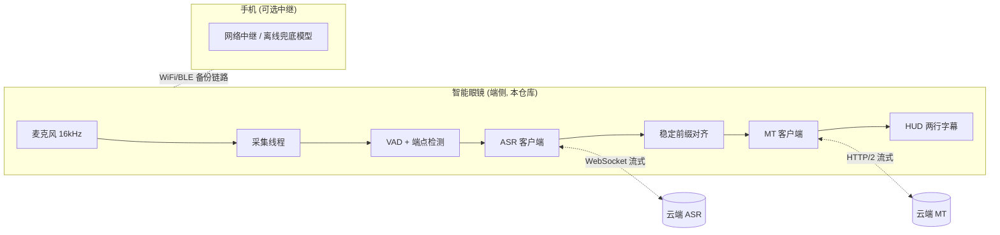
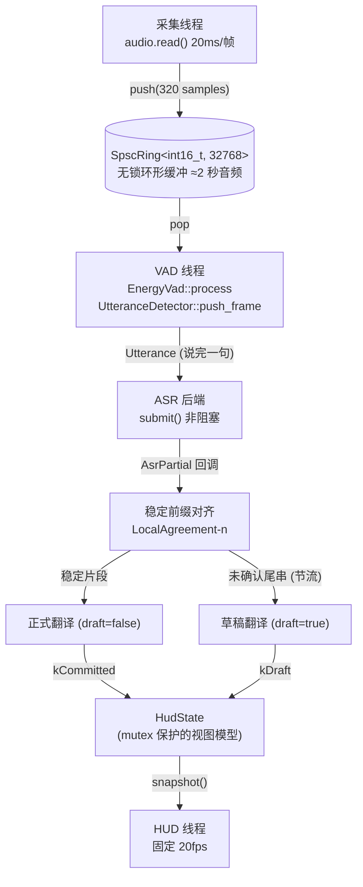

# SubLens 架构设计

> 目标读者: 想看这个项目"到底解决了什么工程问题"的面试官 / 甲方。
> 如果你只想知道怎么跑起来, 看 [README](../README.md)。

---

## 0. 一句话

在智能眼镜上把"听到的话"变成"眼前两行字幕": **端到端 p95 ≤ 700ms**,
核心引擎是纯 C++20、零第三方依赖, 同一份代码跑在 Windows/Linux 桌面和 Android 眼镜上。

---

## 1. 为什么做这个问题

### 1.1 赛道判断

智能眼镜真正的杀手级场景不是拍照, 而是**即时消解语言障碍**: 出境游点餐问路、
涉外会议、听障人士辅助、看无字幕的现场视频。

现有方案的体验断点很明确:

| 方案 | 断点 |
|---|---|
| 手机翻译 App | 要低头看屏幕, 视线离开对方, 对话节奏被打断 |
| 翻译笔 / 翻译机 | 需要递设备给对方, 单句往返, 无法连续对话 |
| 同传耳机 | 要戴两只耳机, 听不到环境音, 且仍是"听"不是"看" |
| 人工同传 | 贵, 会场才有 |

眼镜的独特价值是 **字幕贴在视野里**: 眼睛不用离开对方, 双手空着, 可以边走边说。

### 1.2 技术难点不在模型

ASR 和 MT 都有成熟 API 可用, 真正难的是**延迟预算**和**阅读体验**:

- 流式 ASR 的 partial 结束前一直在改写尾部, 直接翻译上屏会导致字幕反复回退、闪变;
- 云端往返 200~400ms, 端侧再攒句子就很容易超过 1 秒;
- 单目波导显示器的字是"悬在眼前"的, 眼球会下意识追逐变化的部分, 闪烁比手机屏幕更难受。

所以本项目的重心是: **把延迟拆成可测量的阶段预算, 并用"稳定前缀"策略让字幕只前进、不后退。**

---

## 2. 系统边界



| 放在哪 | 做什么 | 为什么 |
|---|---|---|
| **端侧(眼镜)** | 采集、VAD、端点检测、稳定前缀对齐、HUD、草稿节流 | 端点必须本地判: 云端不知道你什么时候说完; 端侧判完直接发一句, 省掉"等静音 + 再往返" |
| **云端** | 流式 ASR、大模型 MT | 精度要求高, 端侧跑不动大模型 |
| **手机(可选)** | 网络中继、断网时跑小的离线模型 | 眼镜 SoC 功耗/散热受限, 手机是更合适的算力缓冲 |

---

## 3. 线程模型

4 条线程, 热路径上没有互斥锁、没有堆分配:



| 线程 | 职责 | 可阻塞点 | 对端到端延迟的贡献 |
|---|---|---|---|
| 采集 | 读音频 → 环形缓冲 | 队列满时反压等待 1ms | ~0 |
| VAD | 取帧 → 端点判定 → 提交语句 | 无(纯 CPU, 微秒级) | **hangover 320ms**(说完到判定说完) |
| ASR 后端 | 网络/模型调用 | 网络(在它自己的线程里) | **首字延迟 ≈260ms** + 尾部收敛 |
| 翻译 | HTTP 调用 | 网络 | **≈180ms**(云端) / 个位数 ms(本地) |
| HUD | 渲染快照 | vsync/定时器 | 1 帧 ≈ 50ms 上限, 实际 <1ms |

### 3.1 反压策略(重要)

队列满时**不丢新样本, 而是让采集线程等一下**: 因为音频是流式的, 丢一段就永久丢了;
而 HUD 端"晚一点"是可接受的。反过来, 如果 VAD 处理不过来(理论上不会, 见基准),
延迟会体现在队列深度上, 由 `PipelineStats::dropped_samples` 暴露出来, 不会静默劣化。

---

## 4. 模块划分

| 目录 | 模块 | 职责 | 关键文件 |
|---|---|---|---|
| `include/sublens/common.hpp` | 基础设施 | 单调时钟、日志、延迟直方图、UTF-8 显示宽度 | header-only |
| `include/sublens/ring_buffer.hpp` | 无锁队列 | 单生产者/单消费者音频通道 | header-only |
| `src/audio/` | 音频输入 | 合成音源、静音源、WAV 文件源 | `scripted_audio_source.cpp` |
| `src/vad/` | 端点检测 | 自适应能量 VAD + 语句切分 | `utterance_detector.cpp` |
| `src/asr/` | 识别 | 流式 ASR 抽象、脚本化模拟器、云端骨架 | `scripted_asr_backend.cpp` |
| `src/mt/` | 翻译 | 翻译抽象、离线短语表、时延注入器 | `phrase_table_mt.cpp` |
| `src/sched/` | **核心算法** | 稳定前缀对齐 + 草稿/正式双路调度 | `partial_stabilizer.cpp` |
| `src/hud/` | 显示 | HUD 状态机、终端 ANSI 渲染 | `ansi_renderer.cpp` |
| `src/app/` | 编排 | 4 线程流水线 + 演示程序 | `pipeline.cpp`, `main.cpp` |
| `bench/` | 基准 | 6 组可复现基准 | `bench_pipeline.cpp` |
| `tests/` | 测试 | 零依赖单测框架 + 各模块用例 | `tiny_test.hpp` |
| `android/` | 端侧适配 | NDK 构建 + JNI 桥 + 极薄 Java 壳 | `jni_bridge.cpp` |

依赖方向是单向的: `app → sched → asr/mt → common`,  `app → hud`,  `app → vad → common`。
所有外部能力(音频、ASR、MT、渲染)都是**接口注入**, 因此:

- 演示/测试时可以塞模拟器(本仓库默认), 不需要网络和模型;
- 换云厂商只需要新写一个 `AsrBackend` / `MtBackend`;
- 接真机只需要新写一个 `IAudioSource`(AAudio)和一个 `HudRenderer`(GLES)。

---

## 5. 五个关键设计决策

### 5.1 端点检测放在端侧, 而不是让云端判句

**问题**: 如果一直挂着 WebSocket 把音频流上去, 云端靠 VAD 判句, 那么"说完"到"云端确认说完"
至少多一个往返(2×RTT), 而且云端 VAD 的延迟不可控。

**方案**: 端侧能量 VAD + `hangover=320ms` 判句末, 一句一提交, ASR 只做"单句识别"。

**取舍**: 引入固定的 320ms 端点延迟, 换来"首包就能整句输入", 首字延迟从 RTT+不定长
变成确定的 260ms; 同时省流量(只传有效语音)。

### 5.2 稳定前缀对齐(LocalAgreement-n), 而不是"每来一个 partial 就翻译"

**问题**: 流式 ASR 的 partial 会改写尾部("我想去**火**" → "我想去**火车站**")。
若每次都整句翻译并上屏, 字幕会闪、会回退 —— 这是同类产品最常见的体验问题。

**方案**: 对最近 N 个 partial 求**最长公共前缀**, 只有连续 N 次一致的部分才送翻译;
标点处强制切分, 尾部过长(24 字符)强制切分兜底。

**取舍**: 稳定片段会比"最新 partial"晚一点(实测半句左右的字), 但字幕单调前进,
不会出现"打出来的字又被吞回去"。

### 5.3 HUD 双行: 稳定行 + 草稿行, 句末一次校正

**问题**: 稳定前缀保证了不回退, 但用户会想"更早看到内容"; 两者冲突。

**方案**: 已提交译文占主行(句内只增不改); 未确认尾部的推测翻译占第二行(灰字、
可整行替换、140ms 节流)。草稿结果到达时如果对应内容已经被正式译文覆盖, 直接丢弃。
另外, 短语级/流式 MT 对"逐段拼出来的前缀"和"整句"给出的译文不是前缀关系(句末会
重排词序), 所以**定稿时用整句译文把主行校正一次** —— 每句最多一次, 用户看到的是
"边说边长出来的草稿 → 说完瞬间变成通顺完整的一行"。

**取舍**: 多云一次整句翻译请求(每句一次, 不是每片段一次), 换来主行最终一定是通顺
的完整译文; 句内不做可见重排, 保证阅读节奏不被打断。

### 5.4 零第三方依赖的纯 C++ 核心

**问题**: 用 OpenCV/gRPC/gtest 会拖慢构建、增大 NDK 包体, 而且在没有网络的机器上装不上。

**方案**: 只用标准库; 测试框架自己写(100 行); 网络层留接口, 不在此仓库硬编码厂商 SDK。
构建只有 `cmake + g++` 两个前置条件, 从 clone 到跑起来不到 1 分钟。

**取舍**: 没有现成的 HTTP/WebSocket 客户端, 真实云接入需要补一层(见
[CLOUD-INTEGRATION.md](CLOUD-INTEGRATION.md)), 但这层本来就是"换厂商要改的地方"。

### 5.5 无锁环形缓冲 + 反压

**问题**: 麦克风回调线程不能被阻塞, 否则丢帧; 但 VAD 与网络线程的调度不可控。

**方案**: 只有两条 atomic cache line 的 SPSC 队列(32768 样本 ≈ 2s), 生产者只写 head,
消费者只写 tail, 互不阻塞。

**取舍**: 队列深度给了 2 秒缓冲, 正常情况下延迟恒为 0; 若下游真的卡住, 延迟会增长,
由 `dropped_samples` 与队列深度暴露, 而不是静默堆积。

---

## 6. 延迟预算(摘要)

详细推导与实测见 [LATENCY-BUDGET.md](LATENCY-BUDGET.md)。

| 阶段 | 预算 | 说明 |
|---|---|---|
| 端点判定(端侧) | 320ms | hangover, 可在 240~400ms 调 |
| ASR 首字 | 260ms | 云端流式首字延迟 |
| 稳定前缀对齐 | ≈0ms | 亚微秒级算法 |
| 翻译(本地/云端) | 1~5 / 180±80ms | 取决于部署方式 |
| HUD 上屏 | ≤50ms | 20fps, 单帧成本 <1ms |
| **合计(云 MT)** | **≈760ms** | 稳态 p95 |
| **合计(本地 MT)** | **≈580ms** | |

> 注意: 上面是"语音结束"到"译文上屏"的口径。用户实际感知还包括"说完到端点判定"
> 的 320ms, 已在合计里。

---

## 7. 可复现的实验方法

没有真机和云端账号也能验证这套设计, 靠两件事:

1. **对话脚本是唯一数据源**(`src/common/scenarios.cpp`): 同一份时间线同时驱动
   合成音频、模拟 ASR、参考译文, 三者天然对齐;
2. **所有外部时延都可注入**: ASR 首字延迟、词推进速度、抖动、错误注入、MT 往返时延
   都是配置项, 所以能在单机上做 A/B 实验。

```bash
cmake -B build -G Ninja -DCMAKE_BUILD_TYPE=Release && cmake --build build
./build/sublens_bench              # 全部基准, 输出 Markdown
./build/sublens_demo en2zh         # 实时演示(约 25 秒)
```

数据不造假的边界: **引擎自身的 CPU 开销、算法正确性、流水线端到端时序是真实测量的**;
云端 ASR/MT 的时延是"参数化注入", 默认值取自公开 API 的常见量级, 在文档里明确标注。

---

## 8. 真机适配清单

| 项 | 桌面(本仓库已实现) | 眼镜端(需适配) |
|---|---|---|
| 音频输入 | 合成音源 / WAV 文件 | AAudio 或 Oboe, 16kHz 单声道, 低延迟模式 |
| 屏幕渲染 | 终端 ANSI 字符画 | OpenGL ES 2.0/3.0 文字纹理(或厂商 HUD 层 API) |
| 网络 | 无(模拟器) | WebSocket + HTTP/2, 断线重连, 弱网降级 |
| 厂商差异 | - | Rokid / RayNeo / Xreal 的 SDK 与显示坐标系不同, 需在 `HudRenderer` 层适配 |
| 功耗 | 未测 | 端侧 VAD 是微秒级, 但 20fps 渲染 + 网络是耗电大头, 需按场景降帧 |
| 安全 | - | 音频不出端侧需本地模型; 云端方案要明确隐私条款与录音开关 |

---

## 9. 已知局限

- 离线翻译器是**短语表 + 模板**, 只保证演示脚本的质量, 不是可用的通用翻译;
- ASR 是**脚本化模拟器**, 不是真实模型; 真实识别率取决于云端模型与口音/噪声条件;
- 没有做说话人分离与语种自动检测(多语种混说场景需要);
- 眼镜端功耗、发热、戴久了的视觉疲劳没有实测数据(需要真机);
- 没有实现端侧离线小模型(whisper.cpp / NLLB 量化)的接入, 只留了接口。

---

## 10. 下一步路线

1. 接真实云端 ASR/MT, 用同一套基准复测端到端延迟(把模拟值换成实测值);
2. 在 Rokid / RayNeo 上做 AAudio + GLES 适配, 出第一版真机视频;
3. 做"离线兜底"模式: 端侧 whisper.cpp tiny + 小翻译模型, 断网可用;
4. 延迟优化: 用 ASR 的 partial 做**提前翻译**(translate-ahead), 在稳定片段到来前预取译文;
5. 语种检测与自动切换(中英混说)。
